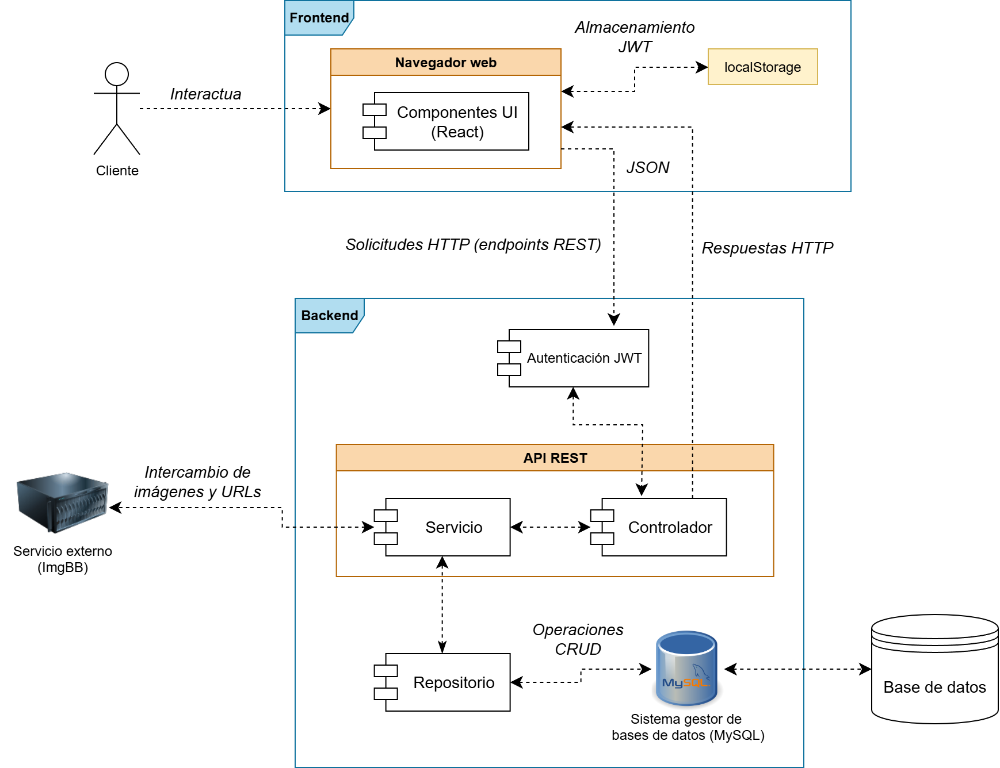
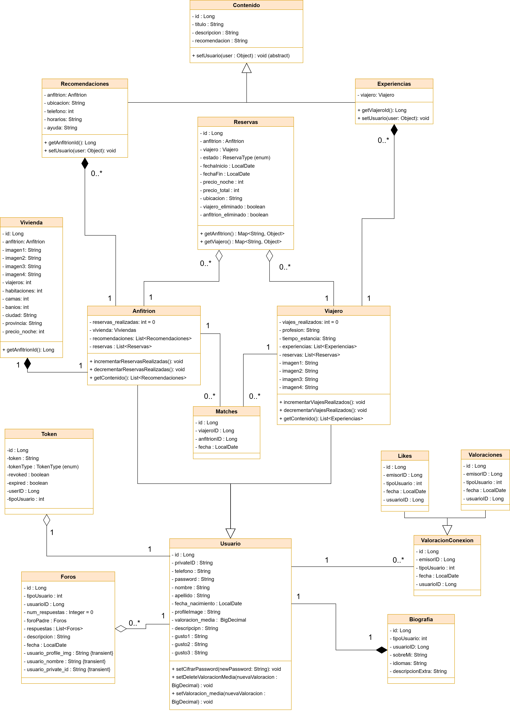

# Bearfrens

[](https://skillicons.dev)

Aplicación web full stack desarrollada como Trabajo de Fin de Grado (TFG) en Ingeniería Informática por la Universidad de Granada (UGR), creada con **React en el frontend** y **Spring Boot en el backend**, cuyo objetivo es poner en contacto a viajeros con anfitriones de forma personalizada. La idea surge para ofrecer alternativas de alojamiento más humanas y económicas, donde los viajeros puedan hospedarse en casas de personas con las que comparten intereses, valores o afinidades, y los anfitriones puedan elegir a los inquilinos que mejor encajen con su estilo de vida, generando así un sistema de emparejamiento más significativo que el simple alquiler. 

La web permite crear y explorar perfiles detallados de viajeros y anfitriones, aplicar filtros según gustos, experiencias y valoraciones, y participar en eventos comunitarios que fomentan la conexión entre ambos perfiles. Todo el sistema está diseñado para ser intuitivo, funcional y eficiente, aprovechando al máximo las capacidades de React y Spring Boot para asegurar una experiencia fluida y sólida tanto en la navegación como en la gestión de datos.

<div align="center">
  
</div>

<br>
<div align="center">
  
</div>
--- 

## 🛠️ Instrucciones para poder visualizar el proyecto

> [!NOTE]
> 
> Antes de ejecutar el proyecto, es necesario asegurarse de tener **Node.js** instalado, disponible en https://nodejs.org/es
>
> Una vez instalado podemos ejecutar en nuestra terminal `node -vp` para verificar que se ha instalado correctamente

> [!IMPORTANT]
>
> **Configuración de la clave API de ImgBB**
>
> Para que la aplicación funcione correctamente, es **fundamental** crear una cuenta en ImgBB (https://es.imgbb.com/signup) y obtener la clave API desde https://api.imgbb.com/. Esta clave debe configurarse en el archivo ``application.properties``, ubicado en ``src/main/resources/``, para permitir el acceso al servicio externo de imágenes. Sin esta configuración, las funcionalidades relacionadas con la gestión de imágenes no estarán disponibles.


> [!CAUTION]
>
> **Configuración del archivo** `application.properties`
>
> Antes de ejecutar el proyecto, es **muy importante** configurar correctamente el archivo `application.properties` ubicado en `src/main/resources/` (explicado en el **Paso 4**). Este archivo contiene las **configuraciones necesarias** para la conexión a la base de datos y otras propiedades clave.


# 📚 Bearfrens - Guía de instalación y ejecución (Windows 10)

## Paso 1: Clonar el repositorio
Descarga el código fuente en tu máquina local:
```bash
git clone https://github.com/{usuario}/{tu_repositorio}.git
cd tu_repositorio
```

## Paso 2: Iniciar MySQL
Asegúrate de que el servicio de MySQL esté activo en tu máquina local. Puedes iniciarlo con el siguiente comando (ajustando la versión instalada):
```bash
net start MySQL<VERSION_INSTALADA>
```

## Paso 3: Configurar la base de datos
Verifica que la base de datos `bearfrens_db` exista. Si no, créala con:
```bash
CREATE DATABASE bearfrens_db;
```

## Paso 4: Configurar el backend

Luego, configura el archivo `application.properties` para definir las credenciales de acceso. Si no existe, créalo en `src/main/resources/application.properties` dentro del proyecto Spring Boot:

```properties
spring.datasource.url=jdbc:mysql://localhost:3306/bearfrens_db
spring.datasource.username=TU_USUARIO
spring.datasource.password=TU_CONTRASEÑA
spring.jpa.hibernate.ddl-auto=update

IMGBB_API_KEY=TU_CLAVE_API

JWT_SECRET_KEY=CLAVE_SECRETA_TOKEN
JWT_EXPIRATION=TIEMPO_EXPIRACIÓN
JWT_REFRESH_EXPIRATION=TIEMPO_REFRESCO

ADMIN_EMAIL=EMAIL_ADMIN
ADMIN_PASSWORD=PASSWORD_ADMIN

spring.servlet.multipart.max-file-size=31MB
spring.servlet.multipart.max-request-size=31MB
```


## Paso 5: Compilar y ejecutar el backend
Desde el directorio del backend, compila y ejecuta:
```bash
mvn clean install
java -jar target/BearfrensBackendApplication.jar
```

## Paso 6: Instalar dependencias frontend
Instala las dependencias necesarias para ejecutar el frontend:
```bash
npm install
```

## Paso 7: (Opcional) Instalar Vite si no está configurado
```bash
npm install @vitejs/plugin-react --save-dev
```

## Paso 8: Iniciar el frontend
Ejecuta el servidor local de desarrollo:
```bash
npm run dev
```

## Paso 9 Verificar la ejecución
El backend debería estar disponible en `http://localhost:8080/` por defecto y el frontend en `http://localhost:3000/`.

